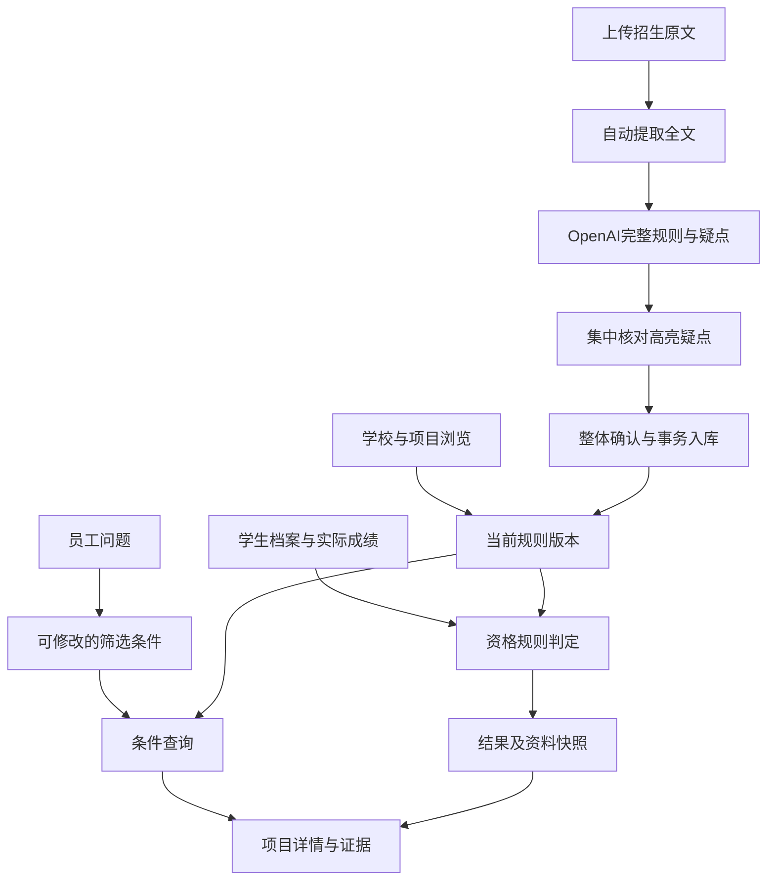

# 逻辑架构与实现

业务依据：`requirements-handoff.md`第0、0A节（2026-10-21），其历史段落不作为当前开发状态。此目录不修改D盘交接原件。

## 数据流

所有入口调用同一个服务及同一份已确认规则对象。AI辅助整理招生原文、生成待核对规则和筛选条件；正式资格结论仍由可追溯的规则引擎计算。

### 待确认材料的日期精度与拦截说明（2026-10-25）

语言成绩有效期的 `validAfter`、`validUntil` 支持原文中的 `YYYY-MM` 月份精度，以及原有 `YYYY-MM-DD` 日期精度。冈山、名古屋待确认文件曾因“2024-09”“2024-12”被日格式校验误拦；现保留原始值及短引，不补造月初或月末日期。匹配时按精度比较，原文明示包含当月时接受当月；边界月包含关系不明确时保留待核实，明确在范围外时不通过。毕业截止日与申请日期仍按各自的日格式规则校验。

校验版本由 `document-review-version.mjs` 统一管理。启动恢复及打开待确认资料时重新校验旧草稿，保存旧整理结果，并保留人工确认的项目归属；不重新请求模型，不改动已发布规则、学生档案或历史版本。入学年份缺失等实质问题继续拦截，确认区域直接汇总具体原因及涉及项目数。天普的单页申请材料清单未注明年份，因此仍需补充有依据的适用年度，不能自动套用其他材料的年份。

## 对象

`program`是某学校／项目／招生通道／年度的规则集合，包含其申请轮次。页面短编号是数据库唯一标识；下一年度或另一通道使用新编号，例如`GLA-2028`，不会覆盖2027。

学校浏览页以学校＋年度组织全部项目，不再以招生通道筛选。`program-presentation.js`仅生成展示标签和可展开的适用项目名单，后台 `channel` 继续用于规则身份、上传关联、匹配及历史。`school-detail.js`生成年度总览和各要求分区，`school-overview.js`负责分区按需呈现、页内导航和项目列表搜索；`project-drawer.js`复用项目详情模板并隔离对话框焦点及滚动。超过8个项目时，资格表改为按共同目录展开具体条件与适用项目；完整条件必须完全一致才合并展示，原项目对象不修改。

规则包含学历路径`paths`、项目通用`hardConditions`、多份语言考试门槛`language`、豁免路径`waivers`、轮次`rounds`、材料`materials`、学费`tuition`及组合申请`combination`。每条可判断条件保留来源文件、页码、引用及规则编号。

数据库表为users、sessions、students、programs、versions、matches、events、documents与meta；共享模式另用files保存原文件和提取文本、settings保存后端模型配置。配置DATABASE_URL时，异步存储适配器直连PostgreSQL（Supabase私有sgu schema）；未配置时兼容原SQLite，不另建同步副本。当前版本更新、不可变版本插入及审计事件在同一事务内提交。写入必须带前一次读取的版本号；不匹配返回409及服务器当前版本，前端展示差异。PostgreSQL通过事务级advisory lock串行化跨实例写入，SQLite通过异步队列持有BEGIN IMMEDIATE直至提交。

上传文件与文档记录在共享数据库中一起持久化，不依赖Railway临时文件系统。Railway定期检查持久化队列，以会话级advisory lock独占某份文档，镜像内Poppler负责文字提取，扫描或含较大图片的页面使用OpenAI逐页识别。页数与文字分页必须一致；完整返回后才保存全文。识别疑点保留物理页码，合入原有整体核对区。缺少密钥进入needs_configuration，不能将空文字继续交给语义整理。恢复调度不能把另一实例正在进行的状态、进度或核对意见覆盖成queued。已有全文继续复用。部署和调试以线上为准，不需要本机工作进程。

`document-workflow.mjs` 管理持久化单任务队列：`queued → parsing → extracting → review → published`。没有模型配置转 `needs_configuration`；失败保留全文和已有草稿，短暂传输失败自动重试一次。重启恢复未完成任务。`document-ai.mjs` 只向官方OpenAI地址发送原文和核对意见，流式读取仅在 `response.completed` 后解析并通过严格JSON Schema校验，拒绝截断、拒答和不完整结构。

状态列表由数据库直接投影摘要，不传输全文和规则草稿；按ID读取详情。恢复轮询只加载正在处理、等待配置或确需升级的文档，不遍历已整理完成的全部原文。批量上传时仍逐份提取与整理，以上优化不改变任务状态、页码、资格条款或整体确认步骤。

多项目手册超过单次模型输出上限时，丢弃截断结果，自动生成完整项目清单并逐项目整理；每次仍发送完整原文，保留共同规定和跨页条件。项目身份必须与清单一致，全部项目完成后才生成同一份整体核对结果。项目清单及已完成部分暂存于文档analysis字段，恢复时复用；原文、模型或核对意见改变后缓存失效。缓存不出现在状态列表，不写入正式项目或历史版本，生成完整核对结果后移除明细缓存。

`document-organizer.mjs` 强制绑定本文件来源，核对引用、页码、数值与必需身份字段。`program-association.mjs` 按学校、年度、项目及招生类别关联已有记录，只归一明确的通道别名；一年级与编入、不同年份仍分开。候选不唯一或类别表述不明确时，在待确认页面选择更新对象或填写独立项目依据。打开待确认资料和确认入库时均重查关联，避免另一份文件先入库后再次创建。已有项目显示版本变化，须选择“更新现有项目”整体确认；`autoReview` 保留完整规则、疑点、变更及预期版本，预览不进入 `programs`。所有项目、历史版本、文件发布状态及审计记录原子提交，重复确认幂等。

上传保存文件 SHA-256；旧 PostgreSQL 文件复用 `files.sha256`。待确认页面提示完全相同的原文件，支持删除尚未入库、未被引用的上传资料。删除校验状态版本，并检查正式项目、历史版本、匹配快照和其他草稿的引用，正在处理或已发布的资料不可删除。删除与确认使用同一事务锁，保留删除审计。

已确认的重复项目仅通过显式维护操作 `mergeDuplicatePrograms` 合并，操作前备份相关记录并核对两个版本。采用较新的已确认内容为原项目新增版本，合并来源；重复行标记 `mergedInto`，原版本和历史快照保持原样。有效项目保存 `mergedProgramIds`，旧链接可定位到现有项目，版本界面可查阅合并前历史，回档生成现有项目的新版本，不重新建立重复项目。

旧 `projectDraft` 保留已有人工编辑。未填写规则的空白壳迁入 `previousManualDraft` 后自动整理；已有实质规则的人工草稿保持可用。关键词建议只作为历史兼容功能，不再要求新上传的用户逐条编辑。

导入项目采用 `semanticVersion:1`；未知条件与时间允许持久化但不会成为自动通过依据。`admissions-content.js` 用于草稿核对；正式学校／项目页统一复用资格、语言、材料、轮次及后续要求模板，由 `imported-requirement-model.js` 提供不修改规则的展示适配，不借用立命馆专属条目编号、豁免或日期。`formal-requirements.js` 保留所有完整条款及已确认后仍待核实的信息。无关的 `verification.*` 条件不扩充全局资格目录，但其本校路径和AND条件仍完整展示。

## 四种判定

| 运算 | 规则 |
|---|---|
| 同时满足 | 明确失败优先；否则未知优先；否则后补条件；否则通过 |
| 满足其一 | 任一路径通过即可；其次完整附条件路径；其次未知；全部明确失败才失败 |
| 预计毕业 | 学校允许、日期明确且早于入学日，返回附条件；未知不伪装成附条件 |
| 材料准备 | 已准备、待准备、未知单独显示，不把没写文书当成资格失败 |
| 申请窗口 | 使用原文确定的日期、时刻和时区，独立于资格；缺失信息标待核实 |

路径G/H/I的年龄规则只在相应路径生效。JDP移除F/H并保留特定专修学校资格限制。不同考试独立评估，不取各次最高单项；TOEFL新旧量表按2026-01-21分界。有效期以所选申请轮次截止日往前2年计算。目标成绩仅在显式模拟中使用。

GLA澳大利亚国内身份例外、Group A英语教育、JDP四年课程及无ESL、其他三项目最近6年全英语等需员工按原文核实后填写，系统保留未知。

原始手册已明确SAT／ACT等学术考试为可选，此事实可以用于“不必额外提供SAT／ACT”查询。一般情况下，仅“未注明”不会推定为可选或不需要。

## 版本与后续工作

匹配记录完整保存学生快照和所用项目版本。打开历史查看原结果；“与最新规则比较”生成另一个新快照，不改写旧记录。回档把指定历史完整规则复制成新当前版本，保留所有中间版本。

核心字段仅新增F021—F025，原19类被排除主题不建立独立模块。来源数据原始135条保留作追溯；网页按已确认范围过滤，不将全部来源主题变为筛选字段。

未连接共享数据库时，`.data`中的数据属于部署实例。Git保存代码和初始招生数据；首次切换共享库需显式迁移已有资料，保留原始JSON、版本、账号和文件。线上快照优先与本地快照合并，相同版本冲突即停止。共享数据库连接失败不得回退到SQLite或重新初始化五个项目。

## 实现取舍

- 原生浏览器模块与CSS，无前端构建；Node 24原生SQLite或pg驱动连接PostgreSQL，使用相同业务模型。
- 默认本地自然语言解析，有语义模型适配接口，未配置时不声称通用AI已连接。
- PDF由本机MinerU标准解析；OpenAI生成的完整规则与正式项目隔离，必须经员工整体确认才发布。
- 员工账号采用scrypt密码哈希，随机会话令牌仅在HttpOnly Cookie，服务端保存令牌哈希；写入验证来源和CSRF。
- 新增复杂字段可通过完整结构维护；目前常用门槛、材料、时间、组合规则均有普通表单。

## 学校总览与统一资格目录（2026-10-21更新）

路由为 `#programs` 学校索引 → `#school/<学校名>` 学校总览 → `#program/<项目ID>` 项目详情。学校页按年度和招生通道隔离，避免把不同版本或通道的条件合为一条。底层仍是项目规则，不另建容易失配的学校规则副本。

上智FLA按用户指定的项目口径展示：一年级入学为“FLA 申请”，编入为“FLA 编入”。两条原有记录同屏列出并分别作为矩阵列及比较对象；原始通道字段仍参与文档身份匹配，不改写存量规则或历史结果。`programLabel` 统一各入口的名称，`schoolViewGroup` 仅把已识别的两类FLA纳入同一学校展示分组，其他学校的通道隔离继续生效。

`requirement-model.js` 提供共用的完整展示模型；`school-detail.js` 按内容和条件归并项目要求，并保留每组的项目ID及全部来源。语言要求归并键包含考试、版本、量表、总分依据、所有单项及备注。材料归并还包含适用条件和完整说明，特殊要求不因名称相同被吞掉。`rounds-table.js` 在学校和项目页复用，每轮一行。

`education-model.js` 维护共享类型、别名及分类，`qualification-matrix.js` 汇总全部当前规则中的独立资格与认证；所有学校和项目使用同一目录，不再按编入通道隐藏字段。可否仍由各项目实际路径及原文决定，单行“可”仍受年限、完成状态、年龄和特殊审查等条件约束。未列明的OSSD／HKDSE等显示“待核”，仅有明确排除依据时显示“否”；单项不适用不否决持有人通过其他完整路径申请。

部分手册把通用学历资格和具体课程体系分章列示。资格表也纳入requirements中明确以该资格命名、有对应原文、属于申请阶段的硬性或附条件条款（如立教HKDSE）。这些是带完整条件和来源的展示依据，不新增或放宽匹配引擎的学历OR路径；附带提及、排除、待核实和后续阶段说明不会被据此标为“可”。

导入学费仍使用published／unspecified，但published不必具有单一amount：多类别收费可保留amount=null、完整detail、币种、周期及来源。校验v3对完整说明提示整体核对，预算计算对空金额保持unknown。public/tuition.js提供统一显示，避免显示null或用0代入。待核对草稿可无模型调用升级校验，已发布项目及学生快照不改写。

## 学历与教育背景（2026-10-23）

### 共同目录与原始名称

三类为并行信息维度，并非三个必须同时满足的条件。所有学校与项目（包括编入）使用同一标准目录；原始条件按项目独立保留，目录不按上传文件重建。展示层将教育经历同类归组，各项目的认可状态、附加条件及出处独立计算。

| 分类 | 共同内容 |
| --- | --- |
| 学历与教育经历 | 十二年正规课程、日本高中毕业、日本以外十二年教育、MEXT等同／境内指定国际学校／海外设施／十一年课程／专修学校高等课程、指定预备教育组合、Arts／Science副学士，以及原有正式学位生完成两学年路径 |
| 课程体系与毕业资格 | IB Diploma、UK GCE A-Level、International A-Level、Abitur、French Baccalaureate、European Baccalaureate、OSSD、HKDSE |
| 学校认证与其他资格 | 单行“认证机构”（WASC、NEASC、Cognia、COBIS、CIS、ACSI）；GED／海外十二年同等学力、日本高卒认定、大学个别认定、外国同等学力考试＋指定预备教育。六种以外的机构按原名称单列 |

| 标准类型 | 保留的主要原始名称 | 不能省略的区别 |
| --- | --- | --- |
| UK GCE A-Level | GCE A-Level、UK GCE AS and A levels、GCE A-Level（具英国大学入学资格）等 | 完整A-Level／仅AS、取得状态、考试机构、英国大学入学资格、项目科目与成绩要求 |
| International A-Level | International A-Level、International AS and A levels、International GCE A-Level等 | 完整A-Level／仅AS、取得状态及项目附加要求 |
| French Baccalaureate | Baccalaureate、Baccalauréat、French Baccalaureate等 | 实际颁发国家、完整升学资格；同名其他国家证书不能直接替代 |
| HKDSE | DSE、HKDSE、Hong Kong Diploma of Secondary Education、Hong Kong Secondary School (High School) Diploma | 实际证书、取得状态、考试年份、指定科目和分数 |
| 认证机构 | 六种原始认证名称，Cognia保留其下机构说明 | 实际学校、课程、就读期间和认证范围；项目只列部分机构时不能外推到全部六种 |

归组只影响显示与检索，不修改 `program.paths`、原始 `requirements`、来源、规则ID、版本或回档记录。单元格显示“可／N项可／否／待核”，备注按可用、明确排除、未明确三类列出具体类型，同结论和适用项目归并。名称后的“!”及状态按钮复用已有悬停／弹窗组件，通过“资格类型—结论—条件与依据”表逐项说明。资格搜索同时匹配标准名称及别名。

`buildQualificationDecisionInfo` 是只读展示适配：明确认可且无冲突为accepted，明确排除为excluded，未列明或证据冲突为unknown。完整A-Level路径不能由仅AS满足，AS-and-A名称下仅AS是否足够仍待核对；French Baccalaureate的同体系别名不会仅因合并而成为“部分”。认证机构的条件和来源按实际路径分别保留，不互借截止日。完整资格路径之间的OR与课程条款的额外要求分开呈现。`detail-hints.js` 安全渲染逐项表，普通材料与语言提示沿用原布局。

`educationDisplayGroups` 引用原目录成员，`buildQualificationDisplayRows` 只对学校／项目矩阵归组。“学历与教育经历”显示四行：高中教育与预备教育；MEXT认定／指定课程；副学士（Arts／Science）；大学学习与学位（含正式学位生学习年限、学分、已获学位等独立条件）。每个成员仍保存原条件、项目范围及来源，完整说明收在“!”中。认可其中一项不会授予其他成员资格，`buildQualificationRows`及学生录入／匹配继续使用原始目录。

资格矩阵使用固定列布局，项目列按显示名称留足宽度，备注保持12px单行摘要；窄屏仅表格容器横向滚动。超长备注显示省略号，行尾“!”提供完整逐项结论、条件与出处；不靠缩小字号或删除条件压缩高度。共用提醒不再重复铺陈；个别审查的既定说明有等义摘要，原规则一旦改变即回退显示新原文，不能沿用过期摘要。

### 目录同义归并及新增资料防回归（2026-10-25）

问题来源是视图构建时把未识别的原始 qualification 值和 path.label 直接追加到公共目录，旧修复只补充了当时已出现的别名，仍允许后续新表述扩充主表；不是导入时清空或重建数据库。对线上35所学校、177个有效项目的只读快照核验，本次修复前教育经历84行、课程资格22行；归并后教育经历4组（高中与预科、MEXT指定课程、副学士、大学学习与学位），课程资格8种常用类型加 Singapore GCE A-Level 和其他外国大学入学资格，共14行。Singapore资格不并入英国或International资格，其他外国大学入学资格仍按项目原文单独核对。

`education-model.js` 的证书别名由目录、学生表单、后端匹配共同使用。`education-catalog.js` 将教育路径的既有字段和明确别名定位到标准类型；包含新增的高中毕业、混合学制、海外教育设施、大学学习年限／学分、短期大学与学位表述。误放在qualification中的教育经历通过单独的只读索引回归教育类别。归组不把 verification 条件改为共享学生事实，也不把年限、学分、专业、语言或截止日移出原始 AND 路径。同一类型可对应不同学校的不同要求，缺证据仍待核实。

未匹配路径仍比对完整原始谓词，保留不同条件和来源，但不再逐条扩充主表：收在“其他原文资格与条件（待归类）”；未归类证书收在“其他原文证书（待归类）”。两者通过既有“!”逐项查看，并显示待核实。新增独立主表类型必须经过明确分类映射；六种以外的认证机构继续按原有例外规则单列。传给后续整理的未知词条带unclassified-source-expression标记，不能被当作已核定的标准类型。旧档案中已经填写的原始资格仍可读取、编辑和保存。

未来自动整理先传入当前标准名称、别名、字段及已经收录的新资格词表，提示先匹配再新增；词表仅用于分类，不提供其他学校的认可结论、成绩门槛或日期。模型仍保留原文名称与完整条件，结果经过同一确定性目录归并。分项目提取和恢复使用相同词表，词表变化会使旧提取缓存失效。上下文与任务指令分开遵循 [OpenAI 提示设计说明](https://developers.openai.com/api/docs/guides/prompt-engineering)。

不修改正式项目、原始资格值、来源、历史版本或匹配快照，无须数据库迁移。旧学生的 `qualification:<原名称>` 或 `other` 类型标记仍可读取和保存，读时投影到新标准类型。仅 AS、英国大学入学资格、Cambridge／Pearson 等指定颁发机构、法国颁发国家与完整文凭状态仍分别校验。仅写A-Level results不推断为完整资格或AS认可，历史记录中的阶段继续待核；Swiss International Baccalaureate的旧标量也不自动补成完整文凭。认证英文全名归到对应六种机构，认证范围及学校上下文检查不变。

ECIS附带年份说明的写法在主表合成一个独立机构字段，原始认可时间范围仍进入逐项目说明及原有匹配逻辑；不把仅填写ECIS视为已满足带年份限制的认可条件。

本次核验全部1283条项目资格路径在归并后均有可追溯展示，35所学校使用相同字段顺序，原始规则JSON未被修改。回归测试覆盖后续多份未知资料不扩充主表、完整条件保留、项目证据不互借、仅AS／成绩表述、旧学生类型标记、认证范围及未解析条件不被标为可申请。

### 学生字段与旧档案兼容

继续使用既有学校、课程、国家、年限、毕业状态与日期；新数据保存在原 `students` JSON中，不建平行表、不需要破坏性SQL迁移。追加字段如下：

- `qualifications[]`：原始 `name`、标准 `type`、独立 `status/date`、完整文凭标记、A-Level `level`、考试机构及必要证书属性。可同时保留多项资格；未另填日期时复用已有毕业日期。
- `accreditations[]`：实际机构与认证范围核对；确认绑定学校、课程、所在地、学制及年限，相关资料改变后重新核对。
- `educationEvidence`、`preparatoryDetail`：补充指定课程／设施等事实与预备教育类别、完成状态及日期；已存在的 `verification.*` 共享教育事实通过映射复用，冲突保留待核实。
- `individualReviews[]`：项目、年度、待审／通过／未通过、日期与依据。旧全局 `individualReview=true` 不能代替特定项目的审批结果。
- `projectEducation`：其余学术科目／资格条件的项目内确认，包含原字段、核对依据、项目版本和学生教育资料指纹。换学校、改资格或项目更新后不能自动沿用旧确认。

旧 `qualification`、`accreditation` 等标量保持原值，通过只读适配投影到新列表；旧名称及无法确定的状态不被删除。新列表一旦明确存在（包括空列表），优先于旧标量，防止取消后旧值再次出现。学校认证与混合AS/A-Level旧数据缺乏关键证据时保持待核实。历史匹配快照原样读取，仅重新匹配生成新结果。

### 匹配原则

`lib/education.mjs` 供既有 `engine.mjs` 调用，不另建匹配服务。一般入学资格与具体项目资格分别输出：前者核对MEXT适用路径，后者继续执行该项目全部原始路径、成绩、科目、年龄、资格时间及轮次约束。二者均有依据后才可判定符合；路径之间OR、路径内AND。预计取得保留既有“附条件”细分，缺失信息为“待核实”，明确冲突为“不符合”。

每个结果保留路径、原子条件、命中的资格记录、缺失信息和依据。同一路径的资格名称、取得状态和日期来自同一资格记录，不能借另一张证书的毕业时间使其通过。仅AS不能通过完整A-Level要求；只有项目原文明确接受AS时才继续核对其他必要条件。认证名称本身不能单独使学生通过；未知机构即使被某项目列明，其一般资格效力仍须另核实。无法自动表达的项目条款保留原文并要求有范围的核对依据。

一般资格依据核对于2026-10-23：[MEXT大学入学资格](https://www.mext.go.jp/a_menu/koutou/shikaku/07111314.htm)、[认可的国际认证学校路径](https://www.mext.go.jp/a_menu/koutou/shikaku/07111314/006.htm)。当前官方页面列明COBIS，但仍须确认是适用学校／课程的认证，而非仅会员身份；具体项目也必须有自己的认可依据。语言成绩模块继续独立，未改变其录入布局及评分逻辑。

## 历史：一次性学生清理（已撤销）

2026-10-22起用户明确要求保留学生档案、匹配和历史，`apply-school-update.ps1` 已移除清理调用。旧清理工具仅作为历史代码存在，本次不执行。正式初始化不导入虚构学生；测试从 `tests/fixtures/students.mjs` 显式建立隔离数据，所有新增保存与匹配测试都使用隔离库。
