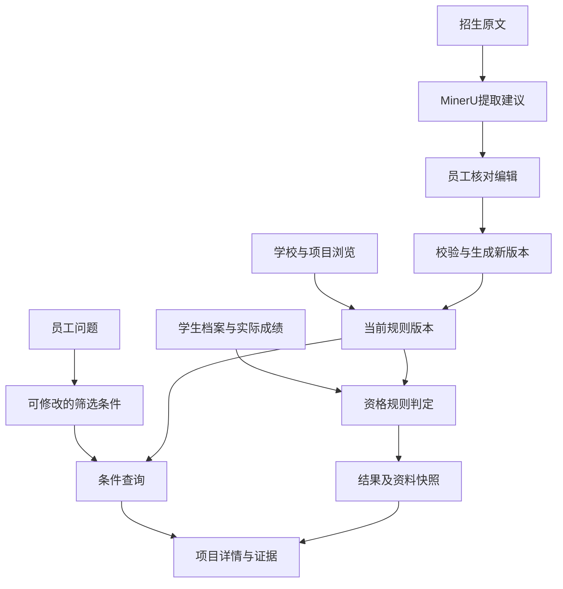

# 逻辑架构与实现

业务依据：`requirements-handoff.md`第0、0A节（2026-10-21），其历史段落不作为当前开发状态。此目录不修改D盘交接原件。

## 数据流

所有入口调用同一个服务及同一份规则对象。AI只辅助生成筛选条件；不参与资格结论生成。

## 对象

`program`是某学校／项目／招生通道／年度的规则集合，包含其申请轮次。页面短编号是数据库唯一标识；下一年度或另一通道使用新编号，例如`GLA-2028`，不会覆盖2027。

规则包含学历路径`paths`、项目通用`hardConditions`、多份语言考试门槛`language`、豁免路径`waivers`、轮次`rounds`、材料`materials`、学费`tuition`及组合申请`combination`。每条可判断条件保留来源文件、页码、引用及规则编号。

数据库表为users、sessions、students、programs、versions、matches、events、documents与meta。当前版本更新、不可变版本插入及审计事件在同一SQLite事务内提交。写入必须带前一次读取的版本号；不匹配返回409及服务器当前版本，前端展示差异。

## 四种判定

| 运算 | 规则 |
|---|---|
| 同时满足 | 明确失败优先；否则未知优先；否则后补条件；否则通过 |
| 满足其一 | 任一路径通过即可；其次完整附条件路径；其次未知；全部明确失败才失败 |
| 预计毕业 | 学校允许、日期明确且早于入学日，返回附条件；未知不伪装成附条件 |
| 材料准备 | 已准备、待准备、未知单独显示，不把没写文书当成资格失败 |
| 申请窗口 | 精确使用日本时间首日10:00与末日23:00，独立于资格 |

路径G/H/I的年龄规则只在相应路径生效。JDP移除F/H并保留特定专修学校资格限制。不同考试独立评估，不取各次最高单项；TOEFL新旧量表按2026-01-21分界。有效期以所选申请轮次截止日往前2年计算。目标成绩仅在显式模拟中使用。

GLA澳大利亚国内身份例外、Group A英语教育、JDP四年课程及无ESL、其他三项目最近6年全英语等需员工按原文核实后填写，系统保留未知。

原始手册已明确SAT／ACT等学术考试为可选，此事实可以用于“不必额外提供SAT／ACT”查询。一般情况下，仅“未注明”不会推定为可选或不需要。

## 版本与后续工作

匹配记录完整保存学生快照和所用项目版本。打开历史查看原结果；“与最新规则比较”生成另一个新快照，不改写旧记录。回档把指定历史完整规则复制成新当前版本，保留所有中间版本。

核心字段仅新增F021—F025，原19类被排除主题不建立独立模块。来源数据原始135条保留作追溯；网页按已确认范围过滤，不将全部来源主题变为筛选字段。

`.data`中的数据属于部署实例。Git保存代码和初始招生数据，推送Git不会修改已运行实例的用户规则；更新初始数据需提供明确迁移，避免覆盖人工修改。

## 实现取舍

- 原生浏览器模块与CSS，避免本地依赖安装；Node 24原生SQLite持久化共享状态。
- 默认本地自然语言解析，有语义模型适配接口，未配置时不声称通用AI已连接。
- PDF由本机MinerU标准解析；关键词建议与正式项目规则隔离。文字、AI建议均不能自动发布。
- 员工账号采用scrypt密码哈希，随机会话令牌仅在HttpOnly Cookie，服务端保存令牌哈希；写入验证来源和CSRF。
- 新增复杂字段可通过完整结构维护；目前常用门槛、材料、时间、组合规则均有普通表单。
