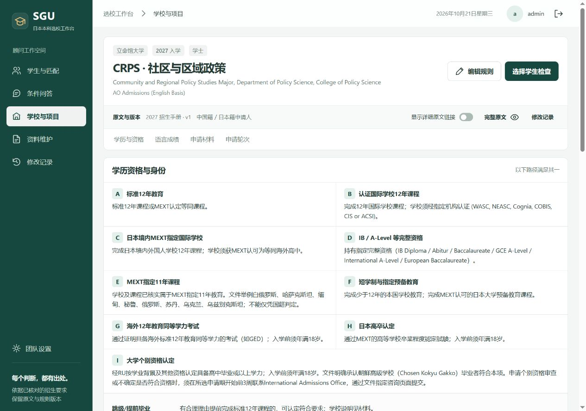
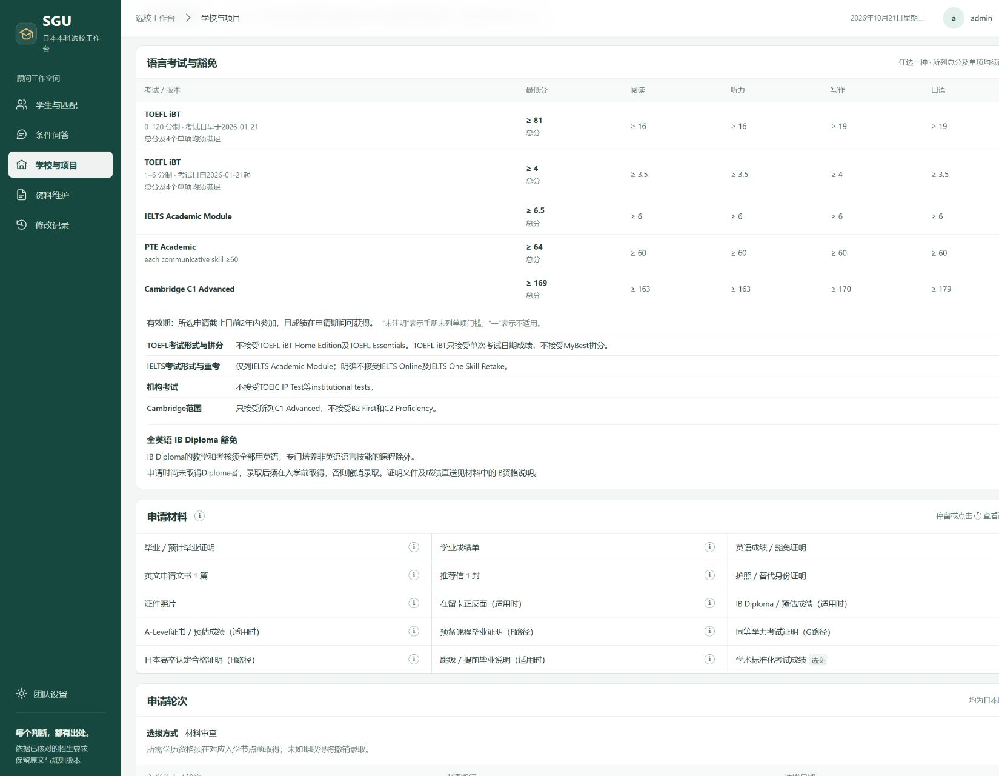
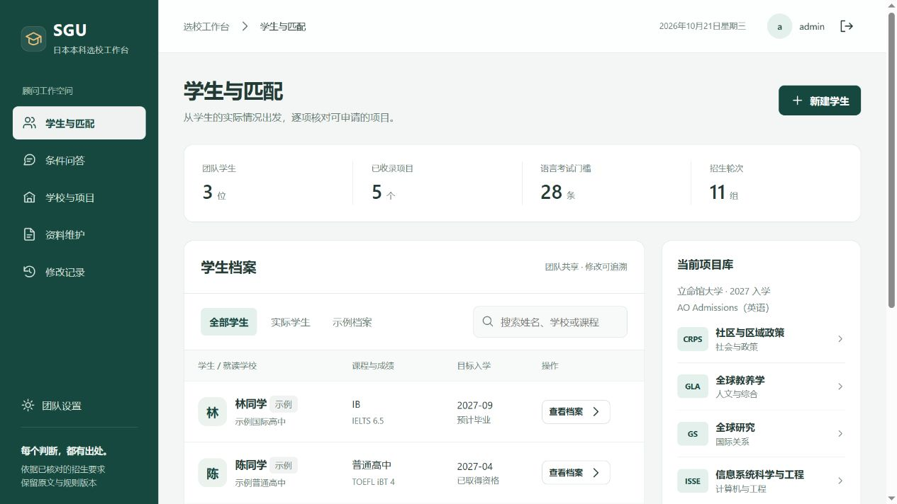

# 验证记录

## 线上独立PDF解析

日期：2026-10-24。根据最新要求，Railway作为主要部署与调试环境，不再要求本机同步运行。Docker加入Poppler，扫描内容调用现有OpenAI模型逐页识别，继续使用统一的高亮疑点和整体确认流程。

- 全量145项测试通过；新增普通PDF不调用视觉模型、物理页数与空白页保留、混合文字／图片表格识别、识别疑点带页码、缺密钥暂停、后续页失败不返回半份结果、临时文件清理、完整响应校验及进程超时／输出上限检查。
- 识别中的可读文字层保留用于交叉核对；扫描识别疑点进入原有整体确认区。扫描待配置时不启动空文本语义整理。
- 原有账号、学生档案、项目规则、版本回档及匹配回归通过；无数据库结构迁移，也不改动已入库规则。
- Railway部署`96513e61-3a5b-4621-9909-0ef0f17b1458`（功能提交`55b95f2`）成功后，在实际线上容器验证全部5份上传PDF的物理页数与文字层：18、24、30、22、21页。完整提取东北大学22页、61,189字符；立教大学第1页通过真实OpenAI文件输入返回完整596字符、无识别疑点，临时单页文件随后移除。此检查未新增招生项目或改变入库状态。
- 线上登录会话、bootstrap、模型配置、历史版本和5份原PDF下载验证通过：6所学校、14个项目、16个版本、6份文档；原PDF的SHA-256和项目内容摘要与迁移后基线一致。临时验证会话已移除。
- 已停止本轮迁移／预览启动的本机SGU进程，并在本机私有环境配置中禁用后台文档任务；正式处理不依赖本机在线。

## 最新一轮：Supabase共享数据与兼容迁移

日期：2026-10-24。原Railway实例有5个初始项目、5个版本及1个账号，本地有14个项目、16个版本及6份资料。两边原始快照均私下备份，未覆盖源SQLite。

- 全量137项测试及语法、资源、PowerShell BOM检查通过。新增异步SQLite事务排队、迁移幂等、冲突回滚、账号合并和跨实例队列恢复检查。
- 在随机隔离的Supabase测试schema运行4项存储测试和16项真实HTTP流程检查：验证TLS、私有schema权限、连接关闭后重新读取、二进制原文件、模型配置、并发写入、事务回滚、文档独占处理、账号、档案、匹配、完整版本回档与上传。测试schema随后删除，未向正式库写入测试学生。
- 正式合并保留线上同名账号密码与登录会话，追加9个已核对项目及CRPS已有后续版本；合并后14个项目、16个版本、6份文档、10份原文件／提取文本，逐条记录及SHA-256文件校验通过。学生与匹配源数据均为0，没有执行清理。
- 切换时发现重复启动DDL与既有会话查询发生死锁，已增加已完成结构版本标记；后续启动仅只读检查，回归检查禁止再次执行DDL。原有schema权限与列结构核对后设置标记，正式业务记录不变。
- 使用实际新服务连接共享库检查bootstrap、版本、模型配置和全部5份上传PDF，返回6所学校、14个项目，PDF哈希与迁移备份一致。临时验证会话随后删除。
- 页面布局、教育资格分类、完整招生规则及语言门槛未修改；既有展示和匹配回归全部通过。独立条件问答模型仍沿用原配置。

## Railway HTTPS提交误拦截

日期：2026-10-24（北京时间）。原线上空注册表单带`Origin: https://sgu.up.railway.app`返回403“不可跨站”，同域HTTP来源却能进入400表单校验，确认是协议识别错误，未创建正式账号。

- 新增`lib/request-origin.mjs`，优先采用显式`APP_ORIGIN`，其次采用Railway服务端公共域名的HTTPS地址；无代理配置时保留本机HTTP／直接TLS行为。来源配置校验严格，拒绝通配、带身份信息或页面路径的配置，不采信客户端转发头。
- 注册和登录使用相同来源判断，HTTPS会话自动设置Secure；原JSON标识、跨站阻断及CSRF验证保留。
- 新增`tests/request-origin.test.mjs`，隔离数据库验证管理员创建、登录、会话操作、错误CSRF、其他域名、HTTP降级、仿冒子域名及转发头；现有API回归改为携带真实本机Origin。全量132项通过，语法／资源／PowerShell BOM及差异格式检查通过。
- 线上验收使用空注册表单：同源应进入400字段校验，外站及HTTP来源应仍返回403；不在正式站创建测试账号或学生数据。

## 历史验证：教育经历继续归并与单行备注

日期：2026-10-23（北京时间）。修改 `public/education-model.js`、`public/qualification-matrix.js`、`public/education.css`、`tests/education.test.mjs` 及交接文档。

- 蓝框两行合为“高中教育与预备教育”，红框两行合为“MEXT认定／指定课程”；教育经历从6行变为4行，全表19行变为17行。原26项资格、各项目认可／排除／待核状态、AND条件、来源和历史记录保留。
- 备注保持12px单行，归并重复提醒，少数项目例外用简短范围标识。个别资格审查的既定说明压缩为含高中学力、18岁、申请期开始前3周和咨询提交要求的摘要；完整原文仍在详情中。超长内容省略，行尾感叹号可悬停／点击展开完整结论和条件。
- 53项相关测试及语法／资源／脚本BOM检查通过；新增验证合并不扩大JDP预备教育认可、两组完整成员保留、组合条件与原文不丢失。原有学历匹配、课程要求及其他模块回归通过。
- 1920px下立命馆17行备注均在一行完整显示；1280px下超长摘要省略，行尾说明入口可用。FLA申请／编入列各74px且无文字溢出，390px下表格内部滚动，弹窗不越界；浏览器无错误。旧名称“MEXT认定等同课程”仍可检索到合并行。
- 正式库只读审计：14项目使用相同26项原始／17行展示字段、教育经历4行，原路径无遗漏，数据库摘要不变。截图：`.qa/education-20261023/merged-single-line-qualifications.png`；测试日志：同目录 `merge-summary-tests.log`。刷新正式页面生效，无需重启。
- 上传前完整回归：`npm.cmd test`共128项通过、0失败；`npm.cmd run check`及差异格式检查通过。源码检查未发现本机密钥；`.env`、`.data/`、`.qa/`、解析缓存`blobs/`和服务锁均不进入Git，现有本机数据保留。

## 历史验证：逐项资格结论

日期：2026-10-23（北京时间）。本轮修改 `public/qualification-matrix.js`、`public/detail-hints.js`、`public/project-detail.js`、`public/app.js`、`public/education-model.js`、`public/education.css`，在现有共用矩阵和提示组件中实现。

- 主表以绿色“可／N项可”、暗红“否”、黄色“待核”代替含混的“部分”；备注直接列出具体类型及适用项目，同结论只写一次。未列明不再显示为明确不接受。
- 名称后的“!”和状态按钮可悬停／点击查看逐项对照表，包含类型、结论、完整条件及原文来源；保留补充背景说明。十二年教育的地理子类未单列时提示核对通用路径，不据学校所在地作排除结论。
- A-Level完整资格与仅AS分别显示；French Baccalaureate的同体系别名统一展示认可结果。认证机构各自保留对应路径、期限和来源，原文冲突保持待核实。课程条款仍是额外要求，不新增学历OR路径。
- 更新 `tests/education.test.mjs`、`tests/imported-detail.test.mjs`、`tests/school-detail.test.mjs`；52项相关测试通过，包括明确排除／未列明分离、项目范围、AS限制、冲突证据、认证条件不串用、逐项说明转义及原始对象不变。语法／资源／脚本BOM检查通过。
- 隔离浏览器核对学校总览、项目详情、状态按钮和逐项弹窗；1280px与390px下无文字越界，窄屏弹窗逐项排列，主表在容器内滚动。备注仍为12px、资格及状态14px；正式库摘要不变，14项目共享26项原始／19行展示字段，全部原路径有对应。
- 截图：`.qa/education-20261023/qualification-decisions.png`、`qualification-decisions-detail.png`；测试日志：同目录 `decision-tests.log`。刷新正式页面即可生效，无需重启服务。

## 历史验证：资格表字号层次

日期：2026-10-23（北京时间）。仅调整 `public/education.css`：资格名称和“可／否／部分”标记由12px增至14px，分类标题由13px增至15px；模块标题18px，项目表头与搜索栏13px。“附加条件与适用说明”的表头、正文和高亮范围仍为12px，说明内项目编号及原文链接字号沿用原样。

- 学校总览与项目详情共用样式，保留此前6行教育经历归组；数据和匹配规则未改动。
- 语法／资源／脚本BOM检查及差异格式检查通过。隔离浏览器确认两类页面的实际字号，1280px及390px下无单元格溢出或页面横向越界，浏览器无错误。
- 截图：`.qa/education-20261023/qualification-fonts.png`。刷新页面生效，无需重启正式服务。

## 历史验证：教育经历同类归组

日期：2026-10-23（北京时间）。学校总览及项目详情中的“学历与教育经历”由13行归并为6行：高中毕业与十二年教育、MEXT认定等同课程、MEXT认定／指定学校与课程、高中相当课程＋指定预备教育、Arts／Science副学士、正式学位生完成两学年。

- 修改 `public/education-model.js`、`public/qualification-matrix.js`，新增仅用于展示的成员映射。名称后“!”保留每个成员的完整条件、适用项目及背景说明；仅部分成员列明时，高亮简短认可范围。原始26项目录及匹配路径保持独立，当前展示为19行。
- `tests/education.test.mjs`补充跨项目共同字段、原路径与条件覆盖、Arts／Science不互相授予资格、截止日约束，以及全部／部分／未列明状态测试；更新学校与导入页面的合并行断言。46项相关测试及语法／资源／脚本BOM检查通过。
- 实际14个项目的展示字段及顺序一致，所有原路径均有对应；正式学生、匹配、项目、版本和操作记录摘要与修改前一致，无数据库迁移或写入。
- 隔离浏览器确认6行、提示框及完整说明正常；桌面各单元格无溢出，390px下表格在容器内滚动，页面无横向越界，浏览器无错误。截图：`.qa/education-20261023/education-grouped.png`。
- 刷新正式页面即可生效，无需重启服务。

## 历史验证：语言分数表与使用规则分区

日期：2026-10-23（北京时间）。学校总览和项目详情在考试分数表后加入“成绩有效期与考试形式”浅绿色标题条及上下分隔线，并收紧正文顶部留白，明确下方已进入有效期、拼分及考试形式等规则。

- 修改 `public/school-detail.js`、`public/project-detail.js`、`public/compact.css`；成绩、条款、匹配和学生数据保持原样。
- 28项相关回归测试及语法／资源／脚本BOM检查通过。隔离浏览器检查学校和GLA项目页，标题条约35px高；390px下页面无横向越界，浏览器无错误。
- 截图：`.qa/education-20261023/language-rules-divider.png`。刷新正式页面即可生效，无需重启服务。

## 历史验证：资格备注版面精简

日期：2026-10-23（北京时间）。修改 `public/qualification-matrix.js`、`public/education-model.js`、`public/education.css`，仅调整展示。

- 相同完整限制按适用项目归并；全部项目相同时不再重复列项目编号。A-Level和French Baccalaureate的黄色说明从每行五段合为一段简短摘要，完整限制及资格取得说明仍在名称后的“!”内。
- 不同AS范围、英国大学入学资格限定及认证机构子集保持分开，不能因摘要相近合并原始条件。原招生规则及学生档案不修改。
- 43项相关回归测试及语法／资源／脚本BOM检查通过；补充检查不同AS和认证范围不被误合并。
- 3226隔离浏览器实测：1280px下截图中的三项资格均为单行、约37px高，每行只有一段高亮；点击“!”可读取全部原说明。390px下表格在自身容器滚动，页面无横向越界，浏览器无错误。
- 截图：`.qa/education-20261023/compact-qualifications.png`；测试结果：同目录 `compact-tests.log`。正式服务无需重启，刷新页面生效。

## 历史验证：统一学历资格基础与匹配

日期：2026-10-23（北京时间）。直接修改现有目录及模块；未调用模型，未重写正式招生规则。

### 实际变更文件

| 文件 | 本轮变化 |
| --- | --- |
| `public/education-model.js`（新增） | 前后端共用的三类目录、八种课程、原始别名、六认证归组、旧数据投影及范围指纹 |
| `public/qualification-matrix.js` | 全校／全项目共同字段、原始路径对应、额外认证单列、部分认可高亮及“!”提示 |
| `public/education-form.js`（新增）、`public/education.css`（新增） | 复用既有档案字段的紧凑多选录入、资格状态、认证范围、个别审查、项目核对及响应式布局 |
| `public/app.js`、`public/index.html`、`public/project-detail.js` | 接入新表单与样式，展示两层资格结论，资料改变时失效旧范围确认，表单内提示不替换编辑弹窗 |
| `lib/education.mjs`（新增）、`lib/engine.mjs` | 多路径OR／路径内AND、逐资格记录判定、一般与项目资格分离、完整A-Level／AS、学校认证与个别审查约束 |
| `lib/query.mjs`、`server.mjs` | 在读状态不擅自当成预计取得；保存前校验新增兼容字段 |
| `tests/education.test.mjs`（新增）、`tests/api.test.mjs` | 新分类、关键资格判断、范围失效、API保存重读与历史兼容回归 |
| `tests/document-auto.test.mjs`、`tests/imported-detail.test.mjs`、`tests/school-detail.test.mjs` | 更新共同字段与六认证归组的展示断言，保留原文、路径及原对象不变检查 |
| `HANDOFF.md`、`docs/architecture.md`、本文件 | 更新最终分类、旧数据适配、当前部署与验证记录 |

### 关键场景与结果

`npm.cmd run check` 通过；`node --test --test-reporter=spec tests/*.test.mjs` 共118项通过、0失败。

| 场景 | 验证结果 |
| --- | --- |
| 全部学校／项目／编入共用字段 | 实际14项目的26项名称、顺序完全相同；所有原始路径均有对应展示 |
| 六认证归组及新机构 | 六种合为“认证机构”；测试中的第七种独立列出；认可子集高亮列出已列明与未列明范围 |
| A-Level名称合并 | 原始名称仍保存；仅AS不通过完整A-Level；明确列明AS的规则还须通过其余条件；英国入学资格单独核对 |
| 多资格路径 | 任一完整路径可成立；同一资格的状态与日期不能借用另一资格；命中路径和资格记录可追溯 |
| IB／OSSD／HKDSE与French Baccalaureate | 在读、完整资格、预计取得及日期独立；法国资格保留颁发国家／原名约束 |
| 学校认证 | 名称不自动通过；需学校、课程、年限、完成状态及认证范围；修改学校背景后原确认失效 |
| 一般与项目资格 | 分别输出依据；项目列明额外认证不意味着一般资格自动认可；一般资格成立也不能绕过项目条款 |
| 预备教育／个别审查 | 预备课程类别和完成日期分别核对；个别审查绑定项目与年度，待审或旧全局标记不自动通过 |
| 项目附加条件 | 需本项目当前版本、依据与当前学生资料确认；其他学校、旧版本或改过的学生资料不能复用 |
| 数据兼容与保存 | 旧标量只读适配，原值保留；多资格／多认证创建、修改、保存、重读通过；明确空数组不恢复旧值；历史匹配快照不变 |
| 无效输入 | 非法日期、年限、列表、状态及重复资格编号被接口拒绝 |

3226隔离浏览器使用当前公开规则副本和虚构学生，实际完成多资格、多认证录入、保存、重读，确认原始名称、AS阶段、独立预计日期、考试机构及认证范围保留；修改资格后旧项目确认取消。认证说明的键盘聚焦及点击详情可见，手机点击表单“!”保持原编辑弹窗与未保存内容。桌面及390px下新资格表和教育表单无页面横向越界；宽表在自身容器滚动。浏览器无应用错误。

正式库在修改前后及重启后只读比对：14个项目、16个历史版本、71条操作记录以及学生／匹配数据摘要完全一致。确认没有进行中的文档任务后，仅重启本项目3210服务，健康检查通过；共享MinerU未停止。没有执行清空、迁移覆盖或正式资料入库操作。

详细结果：`.qa/education-20261023/tests.log`、`data-verification.json`。截图：`qualification-hint.png`、`student-mobile.png`（同目录）。分类及旧数据处理见 [架构说明](architecture.md#学历与教育背景2026-10-23)。

## 历史验证：全局文字重叠检查

日期：2026-10-23（北京时间）。直接修改现有目录，仅调整三份CSS。

- 根因：成绩表固定布局将考试列限制为205px，同时强制名称单行，广岛的Cambridge B1 Preliminary for Schools及EIKEN长名称越过列边界。改为按内容计算列宽，名称、最低分、单项及适用项目保持一行，备注独立弹性列，完整备注仍可展开。
- 广岛13条考试实际行高约28–29px，考试列约250px，最长名称与最低分之间保留间距。学校、项目、文档核对共用修正；没有删减考试名称、分数口径或资格条件。
- 长文件名、规则标题、网格字段在自身区域内换行；移除手机提示按钮的负边距，固定疑点数量标签的必要宽度，防止长摘要挤压标签。
- 3226隔离环境使用当前14个项目、5份公开招生文件及一个合成学生；检查6所学校和14个项目的全部展开条款、原文开关、桌面1280／平板768／手机390px，以及文档核对、对比、学生编辑4步、匹配结果、材料准备、规则编辑、问答、历史、设置。
- 保存118个最终布局检查场景，单元格及规则列无文字越界，页面无意外横向溢出，浏览器无错误。文档黄色疑点背景的8–10px外扩位于父容器留白内，正文未越列。完整备注弹窗在手机下可读。
- 102项自动测试及语法／资源／PowerShell BOM检查通过。正式学生、匹配、14项目和16历史版本的内容摘要与本轮基线完全一致；未调用模型、未改正式资料、未重启正式服务。
- 截图和审计：`.qa/overlap-20261023/hiroshima-exams-fixed.png`、`layout-audit.json`、`data-verification.json`。

## 历史验证：立教DSE显示与东北大学费确认

日期：2026-10-23（北京时间）。直接修改现有目录。

- 立教三个项目均已识别HKDSE完整要求至r7，资格表原先仅读取paths而误显示“否”。现纳入明确命名资格且有原文依据的申请阶段硬性／附条件条款，三列均显示“可”，保留2023及以前最佳五科18／奖学金22、2024及以后最佳四科14／奖学金17、公民与社会发展Attained(A)、英语、换算及课程所在地要求。展示适配不新增匹配OR路径，不改正式规则。
- 东北大两项目原文为日本学生等和国际学生分别收费，amount=null但detail已完整保留。校验v3允许有币种、周期、完整说明与原文的此类费用，保留黄色疑点；负数、缺依据等仍阻挡。空金额绝不按0比较，金额查询／预算／学校／项目／比较均覆盖。
- Markdown转义星号不再导致学费原文短引定位失败。待核对草稿升级仅重做校验；旧autoReview保存在previousAutoReview，并另存本轮备份。正式东北大两个program对象逐项完全一致，未执行确认入库、未调用模型。
- 102项自动测试、语法／资源／BOM检查通过；只读审计12份规则、84条路径、272条完整导入条款。学生、匹配、12项目及14历史版本内容摘要与本轮基线一致。
- 3226隔离浏览器验证：立教DSE三列可、完整门槛可见；东北大两处收费提示与可用的整体确认按钮；无控制台错误。截图：`.qa/unified-schools-20261022/rikkyo-dse-fixed.png`、`.qa/unified-schools-20261022/tohoku-confirm-fixed.png`。
- 确认没有进行中的文档任务后重启正式3210服务，校验v3已应用且健康检查正常；未停止共享MinerU，未读取／复制密钥，未修改学生档案。

## 历史验证：自动导入学校统一展示

日期：2026-10-22。仅改正式学校／项目的展示适配，不改已确认规则或学生记录。

- 最新FLA分类调整：按用户新要求显示“FLA 申请”和“FLA 编入”两个独立项目，学校页同时展示，不用通道下拉切换。项目统计恢复9个；规则ID、原文分类和11个历史版本保留。99项测试与语法／资源检查通过，覆盖两项目同屏、年度隔离、资格与分数归属、各自详情及对象不变。浏览器验证两个入口与同时比较；比较页也保留导入材料名称，区分未注明分数与未列明考试。截图：`.qa/unified-schools-20261022/fla-two-projects.png`。

- 同日后续要求对齐：将学校总览中逐行自适应的标题列改为统一240px，长标题在列内换行，说明和适用项目保持共同起点。浏览器实测上智9行、立命馆3行说明列位置一致，TOEFL ITP标题仍为一行；语法／资源检查通过。只调整样式，截图：`.qa/unified-schools-20261022/after-requirements-aligned.png`。

- 同日认证去重修正：广岛的独立日本境外十二年教育与认证学校课程原被混入同一汇总行，现按具体路径剔除认证重复，只保留独立资格并使用准确名称。六种认证继续保留完整课程、毕业期限和自身来源；跨项目同名路径不会串用。97项自动测试及语法／资源检查通过，只读核对9份规则的78条路径和194条导入细则完整，正式学生、匹配、项目及历史版本内容摘要一致。隔离浏览器截图：`.qa/unified-schools-20261022/certification-dedup.png`。

- 同日文案修正：材料提示中的A–I路径编号改为对应学制、认证和文凭名称；匹配和普通编辑界面也使用资格名称。只读检查9份规则的134项材料说明无遗留字母路径表述，原对象未被改变；22项详情回归及语法／资源检查通过。隔离浏览器验证毕业及A-Level材料说明，完整提交要求和JDP例外保留；截图：`.qa/unified-schools-20261022/qualification-wording.png`。

- 同日较早方案（已被上方最新FLA分类要求替代）：学校索引将上智两个同名FLA入口归并为1个项目并列明2种招生通道，总计8个项目，底层9份规则保留。14项相关回归与语法／资源检查通过；只读核对确认归并不修改对象，浏览器验证FLA搜索及两通道切换正常。截图：`.qa/unified-schools-20261022/fla-single-project.png`。

- 95项测试通过，语法、资源及PowerShell BOM检查通过。新增覆盖共用模板、完整条款与材料保留、学校专属条件隔离、编入与一年级分离、资格别名、未知门槛与明确无最低分区分、不同成绩有效期起算节点。
- 在 `.qa/unified-schools-20261022` 使用9个现有项目的隔离副本，检查上智两通道、项目详情与立命馆；未复制账号、会话或OpenAI密钥。上智默认一年级；编入的两种路径以3个资格行展示，29条完整条款均可展开。
- 桌面1280px下页面无整体横向溢出；每个考试约28至29px一行。长备注可点击展开，IELTS One Skill Retake说明完整保留。原文开关显示85个来源入口，关闭后主表恢复紧凑；立命馆TOEFL ITP后续要求标题保持一行。
- `verification.*` 不再把别校长条件加入立命馆。Cognia含其认证机构的名称归并到同一认证行，六种认证保留；已有完整资格仍按对应项目判断。
- 截图：`.qa/unified-schools-20261022/sophia-unified-desktop.png`。正式3210服务及共享MinerU未重启，学生、匹配、9个项目和11个历史版本内容摘要保持一致。

## 同日验证：文档自动整理与OpenAI接入

日期：2026-10-22。Windows / Node.js 24.15，直接修改 `D:\AI-Yang.cn\SGU`。

- 上传即排队提取原文、识别学校／年份／通道、生成完整项目规则。页面高亮疑点与版本变化，可填写一次修正意见重新整理，最终单按钮整体确认所有项目，无逐项勾选。
- 88项自动测试通过，覆盖严格结构及未知值、完整来源、学校隔离、队列恢复、配置后继续、断流重试、全量事务／回滚、并发版本、重复确认、权限及密钥不泄露；语法、初始规则、资源及PowerShell BOM检查通过。
- 验证真实OpenAI密钥连接及流式Responses调用。发现Node原先未沿用Windows系统代理并修复；长文档非流式返回曾中断，改为流式读取后，上智、早稻田、广岛文档分别生成2、1、1个待核对项目。正式文件未代用户确认入库。
- 真实上智规则暴露“申请首日前两年”与“截止日前两年”的差别；已分别处理，不明确起算点时保留待核实。补充IELTS不要求TOEFL量表、按考试范围识别被禁止形式、入学生日年龄及JST时区测试。
- 原文页码和分段引用自动校验；同类定位提醒在界面归并展开，真正条件冲突保留。升级校验不会再次调用模型，旧未确认结果保留副本；已入库规则不修改。
- 在独立 `.qa/document-auto-ui-20261022` 中，通过真实浏览器完成上传、等待、疑点高亮、一次发布两个示例项目、成功回执及项目完整内容检查。分数表行高约28px，1280px窗口无页面水平溢出，浏览器无应用错误。
- 将真实上智整理结果复制到隔离库，仅验收显示而未确认。截图：`.qa/document-auto-ui-20261022/sophia-review.png`；示例整体确认截图：`overall-confirmed.png`。
- 学生、匹配记录、已有5个项目与7个历史版本按内容摘要核对保留；正式修改范围为模型配置、文档处理状态、提取结果与待核对草稿。未执行学生清理工具，未停止共享MinerU服务。

## 同日验证：语言成绩单行展示

日期：2026-10-22。Windows / Node.js 24.15.0，直接修改 `D:\AI-Yang.cn\SGU`。

- 学校总览与项目详情共用 `public/score-table.js`，将量表、考试日期及精简说明移至最右侧“备注”，分数口径紧跟最低分；原备注和版本文字仍在备注的悬停提示中。
- 50项测试通过；学校总览归并前28条成绩要求、单项目各分数与单项要求、适用项目和完整版本／备注均有验证。语法、规则、资源和BOM检查通过。
- 真实浏览器中，学校总览22行的行高均约29px；1013px内容区域内，考试名称列约161px，备注列约391px，整表无需横向滚动。
- GLA项目详情5条考试要求均保持单行；390px窄屏在表格内部横向滚动，页面无整体横向溢出。显示原文链接后仍保持约29px行高，无浏览器错误。
- 验收使用独立 `.qa/hover-review-20261022` 数据库；正式学生、匹配记录、项目及版本内容摘要前后核对一致。截图：`.qa/hover-review-20261022/scores-single-line.jpg`。

## 同日验证：紧凑提示与学生数据保留

日期：2026-10-22。执行环境：Windows、Node.js 24.15.0；工作目录 `D:\AI-Yang.cn\SGU`。

- `npm.cmd test`：50项通过，覆盖全部资格路径、六种认证及其十二年课程条件、28条语言门槛、完整豁免条件与证明范围。补充验证另一学校若存在独立国际学校路径，不会随重复汇总行一起隐藏。
- `npm.cmd run check`：语法、初始规则、资源与PowerShell UTF-8 BOM检查通过；更新脚本通过PowerShell解析。
- 使用独立 `.qa/hover-review-20261022` 数据库、3224端口，在真实浏览器检查学校总览和GLA项目详情：22项资格、六种认证均可见，无重复汇总行；背景举例不在主表展开，年龄、3周期限及完整分数仍保留。
- 验证豁免提示的键盘聚焦、Escape关闭、点击完整说明；JDP提示保留全部国家／地区范围。长提示按可用空间限高滚动，不再覆盖触发按钮。
- 390px窄屏下豁免名称和适用项目可读，点击后显示完整JDP说明，页面没有整体横向溢出；宽表保留局部横向滚动。
- `apply-school-update.ps1`已移除清空调用。正式数据库仅作只读前后核对；学生、匹配记录、项目规则和历史版本的内容摘要均未变化。没有执行旧清理工具，也没有重启正式服务。
- 截图保存在 `.qa/hover-review-20261022/waiver-tooltip.jpg`。

## 历史验证：学校总览、资格矩阵与学生清理

日期：2026-10-21。执行环境：Linux、Node.js 24.19.0；未连接用户Windows数据库。

- `npm test`：49项全部通过。涵盖原判定及API工作流、新库学生数为0、全部原路径条件映射、六认证逐项拆分、OSSD/DSE未列明、JDP明确排除、新学校资格扩充目录、28条语言门槛及适用项目、材料／豁免／后续细则、11轮日期及条件备注、年度通道隔离。
- 一次性清理测试验证SQLite WAL完整备份、全部学生及匹配快照清除、学生相关操作快照清除、原账号和人工规则保留，以及重复执行时保留新学生。
- `npm run check`：JavaScript与维护CLI语法、初始项目校验、必要资源和所有PowerShell文件UTF-8 BOM通过。
- 使用隔离的happy-dom加载实际app模块及真实seed规则进行DOM交互检查：空学生列表，学校首屏无直接项目入口，学校与项目导航，年度选择，资格搜索，来源开关，材料弹窗，以及新增档案OSSD/DSE选项。工具仅临时安装在 `.qa/`，不加入运行依赖。
- 浏览器无法连接开发容器服务；随后本地文件预览被浏览器URL安全策略拒绝，未尝试绕过。本轮**没有完成真实浏览器的桌面／手机视觉验收**；DOM检查不等同于布局截图验收。
- 当时Windows PowerShell更新脚本无法在Linux实机执行；2026-10-22已撤销清空要求，旧清理步骤不再执行。旧截图和下面的Windows记录属于上一版。

## 历史验证：上一版Windows工作台

验证日期：2026-10-21。执行环境：Windows、Node.js 24.15.0。自动化测试账号、写入、回档及学生新增测试使用独立`.qa/`数据库。实际工作空间已按要求初始化管理员，账号及密码哈希仅保存在本机数据库。

## 自动化

`npm run check`通过所有JavaScript语法检查、五个初始规则结构检查和必要资源检查。`npm test`通过41项测试，涵盖：

- 路径择一与通用条件同时满足、G/H/I年龄限制、JDP路径排除。
- 实际成绩与模拟、日期与量表、单项、有效期、拒绝跨次拼分、禁止考试形式、未知豁免。
- 预计毕业与后补、材料状态与偏好分离、入学后条件不排除当前资格。
- 日本时间截止、并申与跨轮检查、保守自然语言条件、未注明学费。
- 仅账号注册、首个账号管理员身份、8位密码登录、错误密码拒绝、后续员工身份、邀请码、跨站及CSRF校验、学生与规则并发修改冲突。
- 版本更新立即影响查询、历史快照不变、完整项目回档产生新版本。
- 上传与提取仅形成建议、操作日志及备份。
- 项目详情完整保留28条考试／版本的门槛、单项、分数依据与备注；路径B六个认证机构、D完整资格清单、E指定课程范围、G/H/I年龄、I个别审查及JDP排除均有回归检查。
- 六年教育豁免与证明归并、GLA在读IB条件、JDP课程／国家范围、材料细则、空后续栏隐藏、入学节点归入轮次、编辑后数值显示及HTML转义。

## 浏览器

账号简化更新已在浏览器验证：加入团队页面只收集账号、密码和邀请码；管理员可用配置的凭据正常登录，顶部显示账号。新增审计记录使用账号，实际密码未写入源码。

通过内置浏览器实际操作：登录、查看虚构学生、运行匹配并得到7个2027年9月项目轮次、问答歧义澄清、展示5个接受TOEFL且SAT／ACT可选的项目及来源、编辑并保存项目规则为v2、新增学生档案。

发现并修复了项目编号表单控件覆盖`HTMLFormElement.id`导致保存处理未触发的问题，复验成功。浏览器控制台未发现应用错误。

桌面及390×844窄屏已检查。窄屏无页面横向溢出，五项导航改为底部导航，档案列表与表单可使用。临时视口覆盖已恢复。

### 紧凑详情更新

五个项目均已在浏览器打开并核对路径数、语言考试行数及后续要求。CRPS、ISSE不再显示空的后续栏或导航。GLA五行考试的总分和四项门槛均可直接查看，JDP的十行考试及完整教育体系豁免范围保留。

- 原文开关刷新后为关闭，CRPS可见详细来源按钮为0；开启后为62，开关状态同步，关闭后再次隐藏。完整PDF入口始终保留。
- 材料说明支持鼠标停留、键盘聚焦和点击展开；验证了中国高中毕业证明、CSSD材料和JDP成绩单翻译规则。提示框与完整对话框均可阅读长说明。
- 390×844下路径双列、原文开关及材料弹窗可用；文档宽度375px，没有页面横向溢出。语言／轮次表在各自容器内横向滚动，保留全部列。
- 布局使用全宽内容区，收紧导航、面板、表格与共享页面留白。1280px桌面宽度下文档宽度1265px，无页面横向溢出；浏览器未记录应用错误。

[手机预览](screenshots/compact-mobile.png)

## MinerU本地集成

确认本机MinerU 4.0.12服务健康且标准解析可用。使用网站实际解析适配模块读取同一份23页手册，复用有效标准解析缓存，完整读取82854字符，保留第1—23页定位符，形成100条关键词定位建议，状态为“待核对”。未调用远程解析，也未自动修改项目规则。

Windows中直接要求MinerU向网站目录写输出文件曾返回权限错误；适配改为读取MinerU的结构化标准输出，由网站保存结果，复验通过。对错误代码、未完成结果和截断内容会显示失败，不标为完整已核对资料。

### 2026-10-22：解析服务未启动的恢复

- 复现正式环境 `server_not_running`：MinerU 4.0.12 已配置，但 `server status --json` 返回 `running=false`。
- 新适配器自动启动一次本机服务并等待标准解析引擎就绪，实际冷启动验证成功；复用已运行服务，不执行停止、重启、远程解析或强制重解析。
- 重新处理 `2027_April-Overseas_Guide早大.pdf`，正式资料状态由“解析失败”变为“待核对”，完整保留第1—24页定位符、70,593字符与100条关键词定位建议。
- 9项新增测试覆盖服务启动、健康服务复用、服务占用错误、引擎未启用、启动超时、后台任务继续等待、等待上限、服务中途退出和CLI完整输出／错误处理；全套59项测试通过。
- `npm run check` 与 `git diff --check` 通过。正式数据库的学生、匹配快照、项目规则及版本记录在修复前后的数量与SHA-256摘要一致。

### 2026-10-22：上传资料归属与建议分类

- 早稻田文件的封面识别为早稻田大学、2027入学、School of International Liberal Studies 与 AO April Entry (Overseas)。初始操作为新建独立草稿，不再默认编辑立命馆CRPS。
- 既有项目按已确认的学校与年份筛选；跨校、跨年份选择在服务端拒绝。空白草稿不继承他校学历路径、语言门槛、豁免条件、来源页码或日程。草稿支持保存与恢复，未补全的规则无法发布。
- 年龄采用完整单词和明确年龄表达匹配，`page`、`image`、`language`、`passage` 不再误报。目录、图片定位符与HTML排版标签被过滤；真实年龄条件和例外保留。建议不再截在前100条。
- 有明确MinerU页面标记的PDF建议提供页码链接；TXT/Markdown没有可靠页码时继续显示文本行号。已解析文件打开时即使用修正逻辑，不需要重新解析PDF。
- 67项测试通过，覆盖草稿全流程、发布校验、版本冲突、来源关联及原有匹配规则。隔离浏览器测试验证无跨校选项、草稿保存后重新打开、空白门槛及原文页码链接。

### 2026-10-22：资料列表与详情的解析状态同步

- 修复详情读取新状态而列表保留旧状态的问题。开始解析立即更新两处；资料页和已打开详情每3秒读取同一份状态，解析完成后自动显示待核对内容，失败时同步显示错误。
- 解析开始、成功、失败及启动恢复均保存递增状态版本并记录事件，较晚返回的旧请求不能覆盖新结果。轮询不携带提取全文或项目草稿，也不重建上传、学生或项目编辑表单。
- 70项自动测试通过，包含失败后重试、成功/失败的列表与详情一致性、版本递增、旧响应拒绝及原有业务回归。隔离浏览器验证两处同步经历失败→解析中→失败，以及重试→解析中→待核对；关闭详情后列表继续更新，刷新状态保留正在确认的学校输入。
- 正式环境上智文件已解析成功，原有解析结果可直接显示，无需重新解析。

## 未执行的外部环境验证

- 文档整理OpenAI已真实联调；独立的条件问答模型仍未配置，问答继续使用本地条件解析。
- 本次未部署公网主机；Docker构建及外部HTTPS反向代理未在本机执行。
- 正式规则仍以已确认项目为准，新上传文件须整体确认后才纳入匹配，不能推定覆盖所有日本院校。
